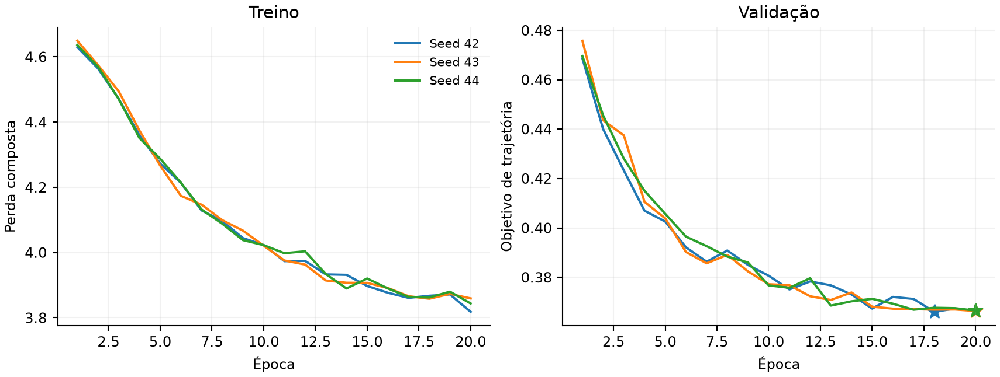
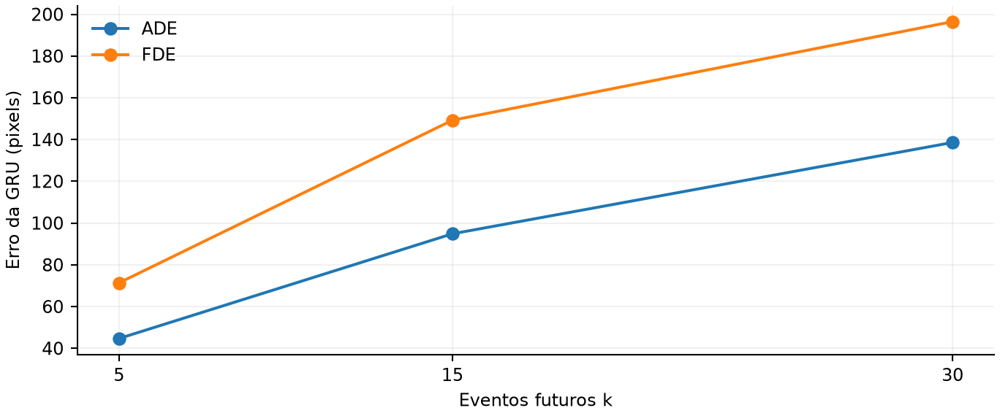
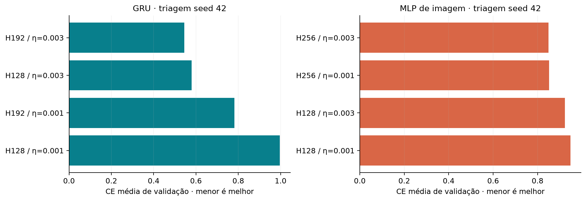
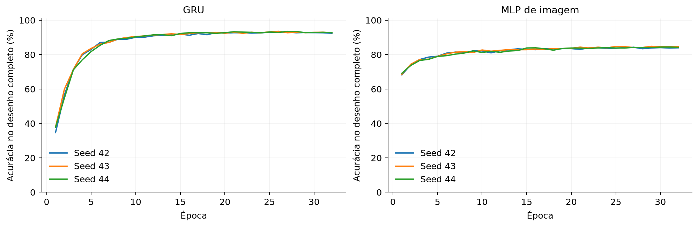
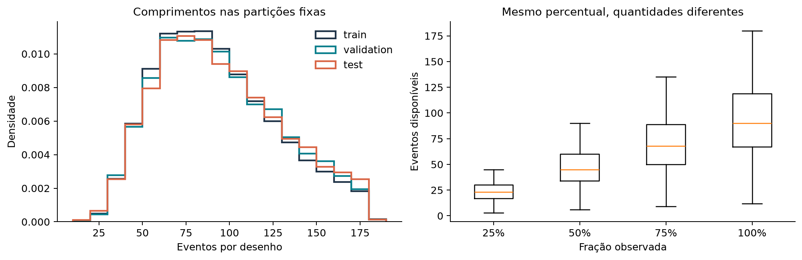
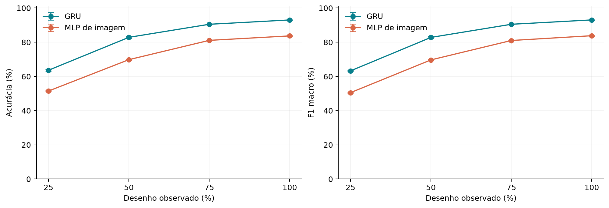
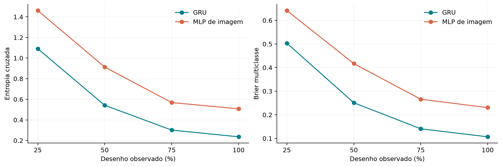
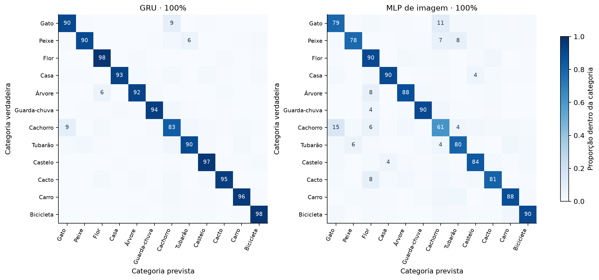
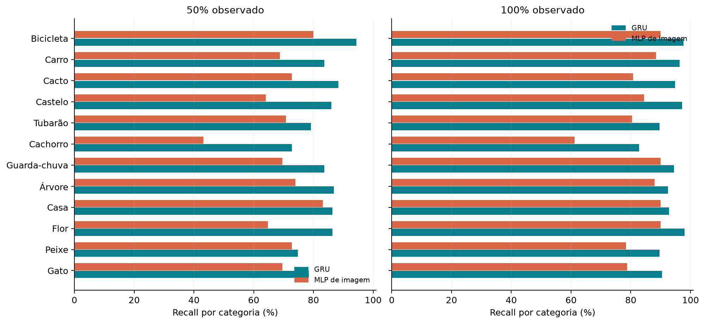
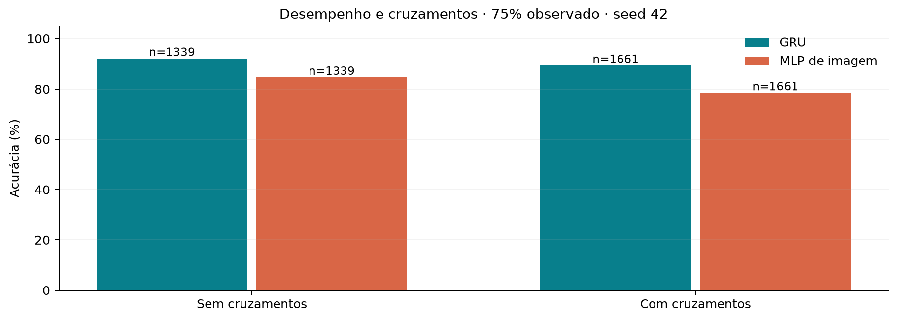

# Previsão de traços e reconhecimento de desenhos com redes neurais

Estudamos duas tarefas de séries temporais sobre desenhos do Quick, Draw!, com as mesmas partições de 42 mil desenhos e 12 categorias. Na Parte I, uma GRU prevê os próximos 5, 15 ou 30 eventos da caneta, condicionada à categoria fornecida. Mostramos continuações bem-sucedidas selecionadas na validação, mantendo a avaliação quantitativa completa do teste. Na Parte II, uma GRU e uma MLP convencional de imagem reconhecem a categoria a partir do desenho parcial, sem receber o rótulo como entrada. No desenho completo, a acurácia média foi 93,0% para a GRU e 83,7% para a MLP, uma diferença de 9,32 pontos percentuais (GRU menos MLP). Com apenas 25% dos eventos, os valores foram 63,6% e 51,5%, respectivamente. Em ambas as tarefas, hiperparâmetros e checkpoints são escolhidos pela validação e as configurações finais têm três inicializações. O relatório combina aprendizagem, métricas e exemplos visuais, distinguindo seleção qualitativa de casos e desempenho agregado. O teste já havia sido observado em estudos anteriores; os resultados não constituem confirmação externa inédita.

## O que fizemos?

Construímos dois experimentos complementares a partir do movimento da caneta. Na Parte I, perguntamos qual será a continuação de um desenho: a rede recebe o passado e uma categoria fornecida e prevê os eventos t+1 até t+k. Na Parte II, perguntamos qual objeto está sendo desenhado: as redes recebem apenas o desenho parcial e devolvem probabilidades para as categorias. Os modelos e os objetivos de treinamento são separados.

Os dados vêm do Google Quick, Draw!, um jogo em que pessoas desenham objetos solicitados. Cada registro contém uma categoria e uma sequência de traços, com coordenadas X/Y e tempos dos pontos. Os limites dos traços indicam levantamentos da caneta. Isso permite revelar o desenho aos poucos e estudar sua evolução, além da imagem final.

Nosso recorte contém 42.000 desenhos de 12 categorias. São 36.000 para treinamento, 3.000 para validação e 3.000 para teste. Retivemos desenhos reconhecidos pelo jogo e mantivemos cada desenho inteiro em uma única partição, compartilhada pelos dois experimentos.

A previsão usa uma GRU, com saída de posições, caneta e tempo. A categorização compara uma GRU temporal a uma MLP convencional sobre pixels. A categoria é entrada apenas na previsão; no reconhecimento, é somente o alvo de ensino e avaliação.

Ajustamos larguras e taxas na validação, repetimos as configurações escolhidas com três inicializações e medimos os resultados em teste. As páginas de previsão destacam situações coerentes e bem-sucedidas; as médias do teste permanecem completas. As páginas de reconhecimento acompanham hipóteses que mudam enquanto o desenho cresce. O site permite explorar as duas tarefas com os modelos treinados.

**As duas perguntas do projeto**

| Experimento | O que recebe | O que devolve |
|---|---|---|
| Previsão t+k | Movimentos e categoria fornecida | Próximos eventos da caneta |
| Reconhecimento | Movimentos ou imagem parcial | Probabilidades de categorias |

## Previsão dos próximos traços (t+k)

### O que significa prever t+k?

A GRU observa uma janela de movimentos até o evento t e prevê onde a caneta estará nos eventos t+1 até t+k. O alvo é uma sequência futura de posições, estados da caneta e intervalos de tempo. Por exemplo, com t=32 e k=15, entregamos somente os primeiros 32 eventos e comparamos a saída com os eventos reais 33 a 47. O modelo não recebe esses 15 eventos durante a inferência.

A categoria do desenho é fornecida nesta tarefa: ao pedir uma continuação de Peixe, já informamos Peixe à rede. Reconhecer a categoria é uma tarefa diferente, tratada na segunda parte, em que esse rótulo deixa de ser entrada e passa a ser a saída. Os pesos de previsão e de reconhecimento são treinados separadamente, embora os desenhos e as partições de origem sejam os mesmos.

Os horizontes são k=5,15,30 eventos amostrados, e não segundos. Os instantes são irregulares; o relógio também é estimado. O objetivo é aproximar o movimento humano que realmente aconteceu dentro desse horizonte, não completar qualquer desenho inteiro de uma vez.

$$
(\mathbf u_{t-w+1},\ldots,\mathbf u_t,\ c)\longmapsto(\widehat{\mathbf y}_{t+1},\ldots,\widehat{\mathbf y}_{t+k}),\qquad k\in\{5,15,30\}.
$$

**Contrato do experimento de previsão**

| Elemento | Conteúdo | Significado |
|---|---|---|
| Passado | Até 64 eventos observados | Só dados disponíveis até t |
| Condição | Uma das 12 categorias | Informada pelo usuário |
| Futuro | 5,15 ou 30 eventos | Posição, caneta e intervalo |
| Conferência | Futuro humano registrado | Usado apenas em perda e avaliação |

### Como os dados entram e os traços saem

Reutilizamos as partições de 36 mil desenhos de treino, 3 mil de validação e 3 mil de teste. A amostragem espacial preserva limites de traços e timestamps; os desenhos preparados têm entre 12 e 180 eventos. Durante o treinamento, prefixos de 8 a 64 eventos variam conforme a disponibilidade do desenho e do lote. O contexto é causal e começa no início do desenho.

Cada evento fornece seis atributos: deslocamentos X/Y divididos pela escala de treino de 28,80 pixels, pen-up, log(1+Δt/0,1), e posições relativas ao primeiro ponto divididas por 256. A categoria vira um embedding de 16 dimensões, formando 22 atributos por evento. Nesta tarefa não usamos a normalização pela caixa do prefixo adotada no reconhecimento. A representação remove translação, mas não garante invariância de escala.

A GRU atualiza seu estado a cada evento. O último estado resume a janela e alimenta o decoder, que estima a continuação usando a última posição e a direção recente da caneta.

O decoder escolhe uma entre 64 trajetórias-base por categoria, aprendidas somente no treino, e estima correções de posição, probabilidades de caneta/fim e intervalos positivos. Na inferência determinística, o modo é escolhido pela própria rede; não escolhemos depois o modo mais próximo do futuro real. Nenhum ponto real novo é realimentado para corrigir a trajetória prevista.

### Ajuste da topologia e das taxas por validação

Para a GRU, testamos 128 e 192 unidades ocultas e taxas iniciais de 0,001 e 0,0005. O orçamento é de 20 épocas, lote 128, AdamW, weight decay 0,00001, gradientes limitados em 1 e taxa cossenoidal até 10% da inicial. A escala isotrópica 0,8–1,2 varia somente no treino. Examinamos quatro candidatos com a seed 42 e repetimos os dois finalistas com a seed 43. A decisão usa a média dessas duas inicializações. A seed 44 replica a vencedora sem participar da escolha.

O checkpoint minimiza a média de ADE/256 +0,1 ×fim precoce nos três horizontes, usando os primeiros 100 desenhos de validação por categoria. A escolha externa usa a validação completa, acrescenta 0,02 ×(1−F1 de pen-up) e compara limiares de caneta 0,2/0,35/0,5. A perda de treino combina classificação do modo, Huber de posição e velocidade, classificação da caneta, erro do relógio e suavidade das correções.

A validação escolheu 192 unidades ocultas, taxa inicial de 0,001 e limiar de pen-up de 0,2. As quatro execuções de triagem foram reaproveitadas de um estudo com o mesmo protocolo. Todos os candidatos e réplicas partiram de pesos novos. A partição de teste já havia sido observada em estudos anteriores.

**Triagem de previsão: seed 42, menor escore é melhor**

| H | Taxa | Época | Validação |
|---|---|---|---|
| 128 | 0,0010 | 17 | 0,3963 |
| 128 | 0,0005 | 20 | 0,4204 |
| 192 | 0,0010 | 18 | 0,3802 |
| 192 | 0,0005 | 17 | 0,4055 |

**Finalistas de previsão: seleção pela média 42/43**

| H | Taxa | Seed 42 | Seed 43 | Média |
|---|---|---|---|---|
| 192 | 0,0010 | 0,3802 | 0,3798 | 0,3800 |
| 128 | 0,0010 | 0,3963 | 0,3912 | 0,3937 |

### Curvas de aprendizagem da previsão

As curvas acompanham a configuração final da GRU nas três inicializações. A perda composta de treino e o objetivo de trajetória na validação têm fórmulas e populações diferentes; sua escala não deve ser comparada diretamente. A estrela identifica o checkpoint selecionado, preservado para a avaliação e para os exemplos. A escolha não usa os desenhos que aparecem nas páginas seguintes como um novo conjunto de treinamento.

Aprendizagem da GRU ao longo das 20 épocas. Cada estrela marca o checkpoint escolhido na validação.

### Avaliação do conjunto e significado das métricas

ADE é a distância média, em pixels, entre cada ponto previsto e o ponto humano correspondente. FDE mede a distância no último evento do horizonte. O F1 de pen-up verifica a separação de traços e o MAE de Δt mede o erro por intervalo em segundos. Uma curva pode ficar próxima e ainda errar um levantamento ou uma pausa; por isso essas dimensões são separadas.

A tabela preserva as médias das três inicializações sobre todo o teste elegível, com prefixos de 16 e 32 eventos e futuro real disponível até o horizonte avaliado. Horizontes distintos exigem quantidades distintas de futuro disponível. A seleção dos bons exemplos visuais não altera esses valores. A galeria mostra situações em que o modelo funcionou; não afirma que todos os desenhos tenham essa qualidade.

$$
\operatorname{ADE}_k=\frac{1}{k}\sum_{j=1}^{k}\|\widehat{\mathbf p}_{t+j}-\mathbf p_{t+j}\|_2,\qquad\operatorname{FDE}_k=\|\widehat{\mathbf p}_{t+k}-\mathbf p_{t+k}\|_2.
$$

**Previsão no teste: médias das seeds 42/43/44**

| k | Janelas | ADE (px) | FDE (px) | F1 caneta | MAE Δt (s) |
|---|---|---|---|---|---|
| 5 | 5914 | 44,67 | 71,31 | 0,131 | 0,059 |
| 15 | 5771 | 94,83 | 149,23 | 0,109 | 0,061 |
| 30 | 5236 | 138,57 | 196,47 | 0,115 | 0,062 |

ADE e FDE da GRU por horizonte, na média das três inicializações.

### Galeria de previsões que fizeram sentido

As páginas seguintes apresentam seis situações positivas, todas da validação: dois casos em cada horizonte 5/15/30 e seis categorias diferentes. Primeiro verificamos erros espaciais baixos, ausência de fim precoce e correspondência de pen-up. Exigimos ainda um trecho contínuo e movimento real não trivial, evitando selecionar apenas uma caneta quase parada. Em seguida inspecionamos as sobreposições para conservar continuações geometricamente coerentes.

Os limites de ADE foram 8/15/25 pixels e de FDE 15/25/40 pixels, respectivamente. A razão entre os comprimentos previsto e real ficou entre 0,6 e 1,4, com ADE de no máximo 7,5% da extensão observada. A revisão escolheu bons exemplos deliberadamente, sem reamostragem de sementes, troca do modo após ver o alvo ou retoques nos pontos previstos. As regras, as contagens da busca e as coordenadas estão nos artefatos do projeto.

Em cada prancha, o passado é escuro, o futuro humano é laranja e a previsão da GRU é verde-azulada. A visão geral mostra a coerência da continuação; o zoom e as curvas X/Y revelam diferenças residuais. O restante do desenho além de t+k fica fora dessa avaliação. Esses casos ilustram acertos locais, sem estimar uma taxa geral de sucesso.

**Casos positivos selecionados para apresentação**

| Categoria | t | k | ADE (px) | FDE (px) |
|---|---|---|---|---|
| Carro | 64 | 5 | 3,18 | 1,28 |
| Cachorro | 64 | 5 | 3,60 | 5,09 |
| Guarda-chuva | 32 | 15 | 10,49 | 10,87 |
| Tubarão | 64 | 15 | 6,67 | 4,74 |
| Árvore | 32 | 30 | 15,07 | 8,80 |
| Peixe | 16 | 30 | 17,49 | 13,37 |

#### Previsão 1 — Carro, horizonte k=5

Categoria fornecida: Carro. A GRU observa 64 eventos e prevê os próximos 5. ADE de 3,18 px e FDE de 1,28 px. Validação, ID 5138668094226432, seed 42.

Caso positivo selecionado na validação e revisado visualmente. O horizonte contém somente os próximos k eventos, não o desenho inteiro. A curva esperada e a curva prevista usam os mesmos índices de eventos; o estado da caneta também coincide neste trecho. O zoom revela diferenças residuais que a visão geral pode esconder. O caso não representa o erro médio no conjunto de teste.

#### Previsão 2 — Cachorro, horizonte k=5

Categoria fornecida: Cachorro. A GRU observa 64 eventos e prevê os próximos 5. ADE de 3,60 px e FDE de 5,09 px. Validação, ID 6040207633678336, seed 42.

Caso positivo selecionado na validação e revisado visualmente. O horizonte contém somente os próximos k eventos, não o desenho inteiro. A curva esperada e a curva prevista usam os mesmos índices de eventos; o estado da caneta também coincide neste trecho. O zoom revela diferenças residuais que a visão geral pode esconder. O caso não representa o erro médio no conjunto de teste.

#### Previsão 3 — Guarda-chuva, horizonte k=15

Categoria fornecida: Guarda-chuva. A GRU observa 32 eventos e prevê os próximos 15. ADE de 10,49 px e FDE de 10,87 px. Validação, ID 6143769634144256, seed 42.

Caso positivo selecionado na validação e revisado visualmente. O horizonte contém somente os próximos k eventos, não o desenho inteiro. A curva esperada e a curva prevista usam os mesmos índices de eventos; o estado da caneta também coincide neste trecho. O zoom revela diferenças residuais que a visão geral pode esconder. O caso não representa o erro médio no conjunto de teste.

#### Previsão 4 — Tubarão, horizonte k=15

Categoria fornecida: Tubarão. A GRU observa 64 eventos e prevê os próximos 15. ADE de 6,67 px e FDE de 4,74 px. Validação, ID 5623840858177536, seed 42.

Caso positivo selecionado na validação e revisado visualmente. O horizonte contém somente os próximos k eventos, não o desenho inteiro. A curva esperada e a curva prevista usam os mesmos índices de eventos; o estado da caneta também coincide neste trecho. O zoom revela diferenças residuais que a visão geral pode esconder. O caso não representa o erro médio no conjunto de teste.

#### Previsão 5 — Árvore, horizonte k=30

Categoria fornecida: Árvore. A GRU observa 32 eventos e prevê os próximos 30. ADE de 15,07 px e FDE de 8,80 px. Validação, ID 4505355939741696, seed 42.

Caso positivo selecionado na validação e revisado visualmente. O horizonte contém somente os próximos k eventos, não o desenho inteiro. A curva esperada e a curva prevista usam os mesmos índices de eventos; o estado da caneta também coincide neste trecho. O zoom revela diferenças residuais que a visão geral pode esconder. O caso não representa o erro médio no conjunto de teste.

#### Previsão 6 — Peixe, horizonte k=30

Categoria fornecida: Peixe. A GRU observa 16 eventos e prevê os próximos 30. ADE de 17,49 px e FDE de 13,37 px. Validação, ID 4765551467429888, seed 42.

Caso positivo selecionado na validação e revisado visualmente. O horizonte contém somente os próximos k eventos, não o desenho inteiro. A curva esperada e a curva prevista usam os mesmos índices de eventos; o estado da caneta também coincide neste trecho. O zoom revela diferenças residuais que a visão geral pode esconder. O caso não representa o erro médio no conjunto de teste.

## Reconhecimento da categoria do desenho

### Objetivo e ajuste dos hiperparâmetros

O objetivo desta parte é classificar uma janela temporal crescente de movimentos da caneta: reconhecer o objeto antes de o usuário terminar. Em vez de fornecer a categoria e pedir uma continuação, como no estudo de previsão, removemos a categoria da entrada e pedimos uma distribuição sobre as 12 categorias. A pergunta experimental é como um sistema que lê a sequência se compara a uma MLP convencional que observa somente o desenho parcial como imagem. Não pressupomos que a GRU ganhe em todo prefixo, categoria ou exemplo. O procedimento de seleção aparece no início para distinguir decisões baseadas na validação das medições de teste. Cada família considera duas larguras e duas taxas, com o mesmo orçamento de 32 épocas. Todos os pesos são novos; não há transferência de redes de previsão ou de reconhecedores anteriores.

**Espaço e decisões comuns**

| Item | GRU temporal | MLP de imagem |
|---|---|---|
| Larguras ocultas | 128 ou 192 | 128 ou 256; segunda camada H/2 |
| Taxas iniciais | 0,003 ou 0,001 | 0,003 ou 0,001 |
| Treino | AdamW; batch 256; 32 épocas | AdamW; batch 256; 32 épocas |
| Regularização | Dropout 0,1 na cabeça; peso 0,0001 | Dropout 0,1 após cada camada oculta; peso 0,0001 |
| Checkpoint | Menor CE média dos quatro prefixos de validação | Mesmo critério |
| Inicializações | 42/43 para seleção; 44 para replicação | Mesmas seeds e regra |

#### Busca, replicação e congelamento

Na primeira etapa treinamos quatro candidatos por família com a seed 42. Repetimos somente os dois melhores com 43; a escolha final minimiza a média das CEs mínimas de validação dessas duas inicializações. A seed 44 treina novamente apenas a configuração vencedora e não participa da decisão. Os dois arquivos de seleção são congelados antes da rotina de teste. O scheduler cosseno reduz a taxa até 10% da inicial; a norma do gradiente é limitada a 1. Cada época apresenta uma das quatro vistas por desenho, amostrada com o mesmo gerador por seed em ambas as famílias. Um piloto de 16 épocas, restrito à validação, mostrou subajuste e foi interrompido. O protocolo principal passou a 32 épocas e às taxas 0,003/0,001 para ambas as famílias; seus pesos foram reinicializados. O piloto não compõe as tabelas de resultados principais. O teste já havia sido observado em estudos anteriores do projeto; o congelamento atual limita a escolha desta comparação, mas não transforma esse teste em confirmação externa inédita.

**Triagem: uma inicialização por candidato**

| Rede | H | Taxa | Época | CE val. |
|---|---|---|---|---|
| GRU | 128 | 0,0030 | 30 | 0,580 |
| GRU | 128 | 0,0010 | 32 | 0,996 |
| GRU | 192 | 0,0030 | 26 | 0,545 |
| GRU | 192 | 0,0010 | 32 | 0,781 |
| MLP de imagem | 128 | 0,0030 | 32 | 0,923 |
| MLP de imagem | 128 | 0,0010 | 32 | 0,948 |
| MLP de imagem | 256 | 0,0030 | 31 | 0,849 |
| MLP de imagem | 256 | 0,0010 | 32 | 0,851 |

**Finalistas: média das seeds 42 e 43**

| Rede | H | Taxa | CE 42 | CE 43 | Média |
|---|---|---|---|---|---|
| GRU | 192 | 0,0030 | 0,545 | 0,534 | 0,539 |
| GRU | 128 | 0,0030 | 0,580 | 0,577 | 0,578 |
| MLP de imagem | 256 | 0,0030 | 0,849 | 0,848 | 0,848 |
| MLP de imagem | 256 | 0,0010 | 0,851 | 0,846 | 0,848 |

Triagem dos quatro candidatos por família, todos inicializados do zero. A seleção utiliza a entropia cruzada média sobre os quatro prefixos de validação; a acurácia final não é o critério de escolha.

#### Capacidade e curvas de aprendizagem

A MLP achata a imagem e aplica camadas densas; cada pixel mantém sua posição espacial no vetor, mas a ordem em que as linhas foram desenhadas desaparece. As larguras não igualam exatamente a quantidade de parâmetros: registramos a capacidade e o custo efetivos para tornar essa diferença verificável. Tempos de treino são da configuração escolhida com a seed 42 na GPU registrada; não incluem preparação, busca inteira ou exportação e não medem a latência do navegador. A GPU do treinamento de reconhecimento foi NVIDIA GeForce RTX 4050 Laptop GPU, com float32, algoritmos determinísticos habilitados e TF32 desligado. As curvas permitem distinguir subajuste, saturação e afastamento entre treino e validação. Uma menor perda de treino por si só não determina o vencedor: usamos o checkpoint selecionado e depois comparamos as previsões no mesmo teste.

**Configurações finais e custo observado**

| Rede | H | Taxa | Parâmetros | Segundos | Época |
|---|---|---|---|---|---|
| GRU | 192 | 0,0030 | 117.516 | 188,5 | 26 |
| MLP de imagem | 256 | 0,0010 | 296.844 | 5,4 | 32 |

Curvas das configurações escolhidas, nas três inicializações. A estrela marca o checkpoint de menor CE de validação. O treino amostra uma vista por desenho e inclui dropout; a validação usa todas as vistas, sem dropout, portanto as perdas não são estimativas idênticas da mesma distribuição.

Evolução da acurácia de validação com o desenho completo. Um checkpoint com maior acurácia final pode ter CE pior nos prefixos iniciais; a escolha privilegia o reconhecimento progressivo, e não somente o resultado ao terminar.

### Dataset e protocolo de avaliação

Usamos 42 mil desenhos do Google Quick, Draw!, divididos em 36 mil de treino, 3 mil de validação e 3 mil de teste. As 12 categorias são: Gato, Peixe, Flor, Casa, Árvore, Guarda-chuva, Cachorro, Tubarão, Castelo, Cacto, Carro, Bicicleta. Há 3 mil desenhos de treino e 250 de validação/teste por categoria. A amostra retém somente desenhos reconhecidos pelo jogo, um filtro que facilita o problema e limita a generalização a rabiscos arbitrários. IDs e geometrias são separados por desenho inteiro; não dispomos de um identificador confiável que assegure independência entre autores.

Os dados preparados preservam coordenadas, fim de traço e timestamps. A amostragem espacial causal conserva limites de traços e instantes originais, com comprimentos entre 12 e 180 eventos. O eixo temporal relevante é a ordem dos eventos da caneta; os intervalos físicos entre eles são irregulares e entram explicitamente na sequência da GRU. Logo, trata-se de classificação de série temporal multivariada, e não de uma coleção de imagens sem evolução.

Avaliamos quatro prefixos: 25%, 50%, 75% e 100% dos eventos de cada desenho, com arredondamento e mínimo de dois eventos. O comprimento final é usado pelo avaliador para definir esses cortes; não é entregue como atributo à rede. Em uso livre, o sistema recebe somente os eventos disponíveis, sem saber a porcentagem que falta. Nenhuma vista parcial aparece em uma partição diferente da do seu desenho de origem.

**Divisão fixa por categoria**

| Partição | Desenhos por categoria | Total |
|---|---|---|
| Treino | 3.000 | 36.000 |
| Validação | 250 | 3.000 |
| Teste | 250 | 3.000 |

Os desenhos inteiros são a unidade da partição. As quatro vistas do mesmo desenho pertencem à mesma partição. A porcentagem observada serve à avaliação; não fornece à rede o comprimento futuro ou a duração final.

### Como apresentamos os dados e a saída

Para cada prefixo, calculamos sua própria caixa delimitadora. Subtraímos o centro dessa caixa e dividimos ambas as coordenadas pela maior extensão observada, com piso de uma unidade. Essa normalização é compartilhada pelas duas apresentações e usa somente o passado. Cada novo ponto pode alterar a caixa e, por isso, a demonstração recalcula o prefixo inteiro; não reutiliza um estado oculto calculado em outra normalização. Não usamos a caixa do desenho completo, a duração final ou uma categoria estimada externamente.

Na GRU, um evento tem seis atributos: deslocamentos normalizados Δx e Δy, indicador pen-up, logaritmo do intervalo de tempo transformado, e posição normalizada x e y. O primeiro deslocamento e o primeiro intervalo são zero. O lote é preenchido até 180 eventos, mas a classificação lê a saída do último evento real; padding à direita não participa dessa decisão. Na MLP, renderizamos apenas os segmentos de tinta, respeitando pen-up, numa imagem binária de 32 por 32 pixels. O vetor de entrada tem 1.024 números, sem timestamp, canal de recência, índice do evento ou rótulo.

Ambas devolvem 12 logits, transformados em probabilidades por softmax. Na equação, X representa a sequência ou o vetor de pixels conforme a rede. O alvo é o índice da categoria verdadeira. A função de perda é entropia cruzada multiclasse; não prevemos coordenadas ou completamos traços nesta tarefa de reconhecimento.

$$
\widetilde{\mathbf q}_i=\frac{\mathbf q_i-\mathbf c_t}{\max(\operatorname{largura}_t,\operatorname{altura}_t,1)},\qquad i\leq t,
$$

$$
\mathbf u_i=(\Delta\widetilde x_i,\Delta\widetilde y_i,p_i,\log(1+\Delta t_i/0{,}1),\widetilde x_i,\widetilde y_i),
$$

$$
\Pr(y=c\mid X_t)=\frac{\exp z_c}{\sum_{j=1}^{12}\exp z_j},\qquad \mathcal L=-\log\Pr(y=y_{\rm real}).
$$

**Exemplo numérico de dois eventos: pontos (100,50) e (108,54), separados por 0,2 s**

| Atributo | Evento inicial | Segundo evento |
|---|---|---|
| Δx normalizado | 0 | 1 |
| Δy normalizado | 0 | 0,5 |
| Pen-up | 0 | 1 |
| log(1 + Δt/0,1) | 0 | 1,099 |
| x normalizado | −0,5 | 0,5 |
| y normalizado | −0,25 | 0,25 |

Os dois classificadores observam exatamente o mesmo prefixo e recebem a mesma normalização geométrica. O rótulo supervisiona a função de perda; nunca integra a entrada. A MLP principal é uma rede densa convencional, sem convolução, agregação de eventos ou estado recorrente.

Duas apresentações do mesmo passado observado. O mapa mostra até 36 eventos e limita apenas a escala de cor; os tensores usados pelas redes não são truncados em valor. O raster é uma união binária dos segmentos de tinta e não revela a ordem, o relógio ou a recência.

#### O que a recorrência pode acrescentar

A GRU atualiza um estado oculto em cada evento. Portas de atualização e de reset regulam quanto do estado anterior é retido e como os novos movimentos entram na representação. Isso oferece uma forma aprendida de combinar o caminho dos traços, sua ordem e as pausas. A MLP recebe todos os pixels do prefixo de uma vez e pode reconhecer estrutura espacial, inclusive antes do fim; sua entrada não permite recuperar de maneira única a ordem usada para produzir uma imagem. Concatenar pontos num vetor e passá-los a uma MLP convencional seria outro controle válido, mas não eliminaria a ordem: cada posição do vetor corresponderia a um instante. Optamos pelo raster porque a pergunta atual é o contraste entre leitura temporal e observação da forma parcial. Como também mudamos a representação, não isolamos uma vantagem causal da GRU sobre toda rede densa possível.

$$
\mathbf r_i=\sigma(W_r\mathbf u_i+U_r\mathbf h_{i-1}+\mathbf b_r),\quad \mathbf z_i=\sigma(W_z\mathbf u_i+U_z\mathbf h_{i-1}+\mathbf b_z),
$$

$$
\widetilde{\mathbf h}_i=\tanh(W_n\mathbf u_i+\mathbf b_n+\mathbf r_i\odot(U_n\mathbf h_{i-1}+\mathbf b_{hn})),
$$

$$
\mathbf h_i=(1-\mathbf z_i)\odot\widetilde{\mathbf h}_i+\mathbf z_i\odot\mathbf h_{i-1}.
$$

### Métricas e interpretação

A acurácia mede a proporção de categorias top-1 corretas. F1 macro calcula o F1 por categoria e faz a média com pesos iguais, destacando classes difíceis mesmo numa amostra balanceada. Top-3 mede a presença do alvo entre as três hipóteses mais prováveis. A entropia cruzada e o Brier multiclasse avaliam a distribuição inteira, não somente o maior valor. O Brier aqui soma os erros quadráticos das 12 probabilidades em cada desenho. O ECE agrupa a confiança top-1 em 10 faixas e pondera a diferença absoluta entre confiança média e acurácia. É uma estimativa dependente dos bins, não uma garantia individual de probabilidade correta. Reportamos os resultados médios de três treinos e mostramos sua dispersão. Para a seed 42, um bootstrap pareado por desenho estima o intervalo da diferença de acurácia entre os dois sistemas. A reamostragem por desenho conserva o pareamento entre as redes; não incorpora a variação completa das inicializações nem a dependência entre autores desconhecidos.

$$
\operatorname{Acc}=\frac1N\sum_{n=1}^{N}\mathbf 1[\widehat y_n=y_n],\qquad \operatorname{Brier}=\frac1N\sum_{n=1}^{N}\sum_{c=1}^{12}(p_{nc}-\mathbf 1[y_n=c])^2,
$$

$$
\operatorname{ECE}=\sum_{b=1}^{10}\frac{|B_b|}{N}\left|\operatorname{acc}(B_b)-\operatorname{conf}(B_b)\right|.
$$

### Resultados: reconhecer enquanto o desenho acontece

No desenho completo, a acurácia média foi 93,0% para a GRU e 83,7% para a MLP, uma diferença de 9,32 pontos percentuais (GRU menos MLP). Com apenas 25% dos eventos, os valores foram 63,6% e 51,5%, respectivamente. O reconhecimento precoce deve ser medido no mesmo prefixo de cada desenho. Não basta mostrar uma animação de uma imagem final já conhecida: as probabilidades exibidas no software são recalculadas com o passado disponível. Os erros iniciais podem ser plausíveis, pois o mesmo contorno parcial é compatível com vários objetos. A hipótese temporal tem interesse justamente nessa ambiguidade, mas uma classificação pode mudar ao longo do desenho e não há garantia de confiança crescente ou acerto permanente.

**Reconhecimento no teste: médias das três inicializações**

| Observado | Rede | Acurácia | F1 macro | Top-3 |
|---|---|---|---|---|
| 25% | GRU | 63,6% | 0,633 | 89,5% |
| 25% | MLP de imagem | 51,5% | 0,505 | 82,7% |
| 50% | GRU | 82,9% | 0,828 | 96,8% |
| 50% | MLP de imagem | 69,8% | 0,697 | 90,8% |
| 75% | GRU | 90,5% | 0,905 | 98,6% |
| 75% | MLP de imagem | 81,1% | 0,810 | 95,6% |
| 100% | GRU | 93,0% | 0,931 | 98,8% |
| 100% | MLP de imagem | 83,7% | 0,838 | 95,5% |

Desempenho progressivo no teste: média e desvio padrão entre as três inicializações. Ambas as redes podem reconhecer antes do fim. As barras medem variação entre seeds; não são intervalos de confiança populacionais.

#### Probabilidades e confiança

Uma rede pode acertar mais e ainda fornecer probabilidades mal calibradas. As medidas abaixo complementam o top-1: valores menores de CE, ECE e Brier são desejáveis. Não ajustamos uma temperatura usando o teste. A linha de confiabilidade ajuda a verificar se grupos de desenhos com confiança próxima de 80%, por exemplo, acertam aproximadamente nessa frequência. A confiança exibida para um único rabisco não deve ser interpretada como garantia de correção. No desenho completo, o ECE médio foi 0,027 para a GRU e 0,012 para a MLP. A rede com maior acurácia não necessariamente tem o menor desvio de calibração. A comparação por classe e os exemplos revelam situações escondidas pela média. Confusões como casa/castelo, gato/cachorro ou peixe/tubarão são compatíveis com formas compartilhadas, mas a matriz observada é que determina quais pares realmente concentraram erros neste recorte.

**Qualidade probabilística: médias das três inicializações**

| Observado | Rede | CE | ECE | Brier |
|---|---|---|---|---|
| 25% | GRU | 1,091 | 0,059 | 0,503 |
| 25% | MLP de imagem | 1,461 | 0,067 | 0,642 |
| 50% | GRU | 0,542 | 0,031 | 0,251 |
| 50% | MLP de imagem | 0,913 | 0,019 | 0,417 |
| 75% | GRU | 0,302 | 0,025 | 0,141 |
| 75% | MLP de imagem | 0,569 | 0,015 | 0,266 |
| 100% | GRU | 0,236 | 0,027 | 0,107 |
| 100% | MLP de imagem | 0,507 | 0,012 | 0,230 |

Qualidade das probabilidades, além do acerto da classe mais provável. Entropia cruzada e Brier menores são melhores; a CE penaliza fortemente erros com confiança excessiva. O Brier usado soma os erros quadráticos das 12 classes, sem dividir por 12.

Diagramas de confiabilidade da seed 42 em 10 faixas de confiança. A diagonal representa confiança compatível com a frequência empírica de acerto. Marcadores maiores indicam grupos com mais desenhos; faixas vazias são omitidas. Não houve ajuste de temperatura após o treino.

#### Variação entre treinos e diferenças pareadas

As três inicializações produzem trajetórias de otimização diferentes, mesmo com configuração e dados fixos. A tabela por seed evita resumir toda a comparação por um único checkpoint favorável. A análise pareada usa a seed 42 para ambas as redes e conserva os mesmos desenhos. Intervalos acima de zero favorecem a GRU; abaixo de zero favorecem a MLP; um intervalo que inclui zero não resolve a diferença sob essa análise. O teste de referência já foi visto no desenvolvimento anterior, de modo que esses intervalos são descritivos do recorte, sem reivindicação de confirmação externa inédita.

**Acurácia no teste, por inicialização**

| Rede | Seed | 25% | 50% | 75% | 100% |
|---|---|---|---|---|---|
| GRU | 42 | 63,3% | 83,4% | 90,6% | 93,0% |
| GRU | 43 | 64,1% | 82,3% | 90,3% | 92,9% |
| GRU | 44 | 63,5% | 82,9% | 90,6% | 93,2% |
| MLP de imagem | 42 | 51,4% | 69,5% | 81,2% | 83,4% |
| MLP de imagem | 43 | 51,3% | 69,9% | 81,2% | 83,7% |
| MLP de imagem | 44 | 51,7% | 70,1% | 80,9% | 84,0% |

**Diferença pareada de acurácia: GRU menos MLP, em pontos percentuais**

| Observado | Desenhos | Diferença | IC bootstrap 95% |
|---|---|---|---|
| 25% | 3.000 | 11,93 | [10,10; 13,80] |
| 50% | 3.000 | 13,93 | [12,07; 15,63] |
| 75% | 3.000 | 9,37 | [7,87; 10,80] |
| 100% | 3.000 | 9,63 | [8,27; 11,07] |

Diferença pareada de acurácia e intervalo bootstrap de 95%, reamostrando desenhos inteiros. Valores positivos favorecem a GRU. Esta incerteza amostral condiciona-se aos pesos da seed 42 e não incorpora toda a variabilidade do treino ou a dependência entre autores desconhecidos.

### Categorias, cruzamentos e evidência visual

A matriz de confusão explicita quais categorias recebem as previsões erradas, enquanto o recall por classe mostra quanto do alvo é recuperado. Conservar somente a média global impediria perceber uma categoria em que a MLP seja competitiva ou uma em que mais contexto não resolva a ambiguidade. A classificação refere-se somente às 12 categorias treinadas: sol, maçã, relógio ou bola de basquete são exemplos conceituais de ambiguidade, mas não fazem parte deste experimento e não são usados como demonstração de desempenho. O fato de a GRU ler uma linha de cada vez não implica separar perfeitamente partes de um objeto. Em uma sequência também existem ruído, traços incompletos e padrões de execução variáveis. Detectamos cruzamentos como interseções próprias entre segmentos de tinta não adjacentes, sem contar simples encontros de extremidades. O grupo com cruzamentos pode ser mais complexo ou conter outras categorias; a análise estratificada é descritiva e não permite afirmar imunidade a sobreposição.

Matrizes de confusão normalizadas por categoria, seed 42, no desenho completo. A diagonal reúne os acertos; cada linha soma 100%. Apenas células de pelo menos 4% recebem rótulo, evitando poluição visual. A escala de cor é compartilhada.

Sensibilidade por categoria na seed 42, com metade e com a totalidade do desenho. Médias globais escondem pares difíceis e ganhos desiguais. O teste tem 250 desenhos por categoria; estes resultados não indicam desempenho em categorias ausentes.

Comparação descritiva entre desenhos com e sem cruzamentos no prefixo de teste. Os grupos podem diferir em categoria, número de pontos e complexidade; uma diferença não demonstra imunidade a sobreposição nem efeito isolado dos cruzamentos.

### Sondas de ordem, pausas e pen-up

O teste mais direto da informação temporal é conservar a imagem e mudar a ordem dos traços inteiros. Invertemos a sequência desses traços sem alterar sua geometria; a união de pixels permanece exatamente igual. Como uma MLP determinística recebe o mesmo vetor, sua saída também deve ser idêntica. A GRU recebe outra sequência e pode alterar a classe ou apenas redistribuir probabilidades. Para separar uma simples mudança de relógio ou do pen-up final, a referência e a sequência reordenada usam intervalos uniformes e fecham igualmente o trecho parcial, forçando o pen-up do último evento antes da permutação. Essa referência modifica conjuntamente relógio e fechamento; não é uma ablação isolada do tempo. Aplicamos ainda duas sondas aos tokens da GRU: zerar o canal de pen-up e zerar o intervalo transformado. O raster original é preservado, portanto a entrada da MLP não muda nessas duas condições. Ocultar pen-up não apaga a geometria nem os saltos de deslocamento, que ainda podem indicar separações. Isso testa dependência dos canais sob perturbação, sem treinar novamente as redes. Sensibilidade não significa benefício: uma mudança pode corrigir ou introduzir um erro. A acurácia sob essas sondas é separada da avaliação principal e se refere a 240 desenhos de validação balanceados, com 75% dos eventos. No reordenamento com relógio controlado e fechamento comum do trecho parcial, a GRU alterou o top-1 em 27,9% dos desenhos e sua acurácia passou de 79,6% para 65,0%. A MLP alterou o top-1 em 0,0%; sua entrada permaneceu idêntica. Na GRU, ocultar pen-up resultou em acurácia de 78,8% e ocultar o relógio em 61,3%; o original atingiu 88,8%. 

**Sondas de validação: qualidade e mudança da distribuição**

| Rede | Condição | Acurácia | Top-1 mudou | Média |Δp| |
|---|---|---|---|---|
| GRU | Original | 88,8% | 0,0% | 0,0000 |
| MLP de imagem | Original | 84,6% | 0,0% | 0,0000 |
| GRU | Sem pen-up | 78,8% | 15,8% | 0,0266 |
| MLP de imagem | Sem pen-up | 84,6% | 0,0% | 0,0000 |
| GRU | Sem relógio | 61,3% | 38,3% | 0,0654 |
| MLP de imagem | Sem relógio | 84,6% | 0,0% | 0,0000 |
| GRU | Relógio + fecho | 79,6% | 18,8% | 0,0349 |
| MLP de imagem | Relógio + fecho | 84,6% | 0,0% | 0,0000 |
| GRU | Traços invertidos | 65,0% | 27,9% | 0,0519 |
| MLP de imagem | Traços invertidos | 84,6% | 0,0% | 0,0000 |

Inverter traços inteiros preserva sua geometria e a imagem binária, mas altera a sequência recebida pela GRU. As numerações identificam a ordem de início dos traços. O relógio é uniformizado e o trecho parcial é encerrado em ambas as sequências, evitando atribuir ao reordenamento uma mudança do intervalo ou somente do pen-up final.

Sondas exploratórias em 240 desenhos de validação balanceados, com 75% dos eventos. A alteração de classe em ordem invertida usa como referência a ordem original com relógio também uniforme e fechamento comum do trecho parcial; as demais alterações usam o original. Pen-up e relógio são ocultados apenas nos tokens da GRU, conservando o raster da MLP. As sondas são fora da distribuição, sem retreino, e não estimam efeitos causais.

#### Tamanho, posição e reconhecimento precoce

A normalização geométrica explícita remove translação e escala positiva uniforme das duas apresentações quando a extensão permanece acima do piso de uma unidade, salvo arredondamento numérico e discretização. Prefixos degenerados abaixo desse piso são uma exceção. Isso não é uma propriedade automática da recorrência, nem decorre apenas de usar deslocamentos: multiplicar um desenho por um fator também multiplica Δx e Δy se não houver normalização adicional. Rotações, deformações e mudanças na relação entre largura e altura não foram removidas por esse procedimento. Ambas as redes podem reconhecer antes do fim, pois ambas observam um prefixo que pode já conter evidência suficiente. Uma observação isolada de acerto em 25% não prova que a classe seguirá correta até 100%; o software mostra a evolução das probabilidades e suas possíveis reversões. A tabela de acerto estável verifica somente os quatro checkpoints avaliados, e não todos os pontos intermediários: uma entrada em f exige acerto em f e em cada checkpoint seguinte. Sem sufixo correto significa falha em 100%, podendo haver acertos anteriores; não significa que a rede nunca acertou. Os exemplos de validação são selecionados por critérios registrados, incluindo casos favoráveis a cada rede e casos ambíguos. São ilustrações, sem substituir as médias do teste.

**Correta em todos os checkpoints observados de f até 100%: seed 42**

| Rede | f=25% | f=50% | f=75% | f=100% | Sem sufixo correto |
|---|---|---|---|---|---|
| GRU | 56,8% | 79,2% | 88,6% | 93,0% | 7,0% |
| MLP de imagem | 36,3% | 57,8% | 73,8% | 83,4% | 16,6% |

Desenhos reais de validação e probabilidade atribuída à categoria verdadeira à medida que os eventos chegam. A figura mostra o desenho completo apenas para orientar o leitor; cada ponto da curva é calculado com o prefixo correspondente. Os exemplos são escolhidos por regras determinísticas registradas, incluindo diferenças favoráveis a cada rede; não estimam a média do teste.

### Galeria progressiva: desenhos e hipóteses, passo a passo

As pranchas seguintes mostram o desenho sendo revelado em cinco etapas: aproximadamente 10%, 25%, 50%, 75% e 100% dos eventos. Cada coluna contém o prefixo real, sua imagem binária, as três categorias mais prováveis de cada rede e P(alvo), a probabilidade da categoria verdadeira, mesmo quando ela não aparece no top-3. O número de eventos e o tempo observado identificam cada corte; os percentuais pedidos são arredondados para eventos inteiros. A curva inferior resume a evolução da probabilidade do alvo com mais cortes intermediários. Todos os desenhos dessas pranchas são da validação e todos os valores são recalculados com os pesos efetivos da seed 42, sem receber pontos futuros. Há exemplos das 12 categorias, incluindo contrastes favoráveis a cada rede, com ID e regra de escolha explícitos. Os casos selecionados não substituem as métricas agregadas do teste. A forma cresce por acréscimo de eventos; não ampliamos artificialmente o desenho para sugerir ganho de informação. O peixe mostrado na captura enviada durante o uso do site foi desenhado livremente pelo autor: eram 27 eventos, 6,4 s observados e um traço. Os valores exibidos, transcritos abaixo e arredondados pela interface, registram um erro concreto da MLP. Como a sequência original desse desenho não foi salva, não inventamos sua evolução nem recalculamos suas probabilidades. O peixe que abre a galeria é outro desenho, identificado no conjunto de validação, escolhido para ilustrar a mesma confusão Peixe/Cachorro; ele não é uma reconstrução da captura.

**Registro da captura do desenho livre: hipóteses exibidas pelo site**

| Rede | Primeira hipótese | Segunda hipótese | Terceira hipótese |
|---|---|---|---|
| GRU | Peixe (97,5%) | Tubarão (1,8%) | Cachorro (0,7%) |
| MLP comum | Cachorro (33,9%) | Peixe (17,4%) | Tubarão (14,5%) |

#### Caso 1 — Peixe — confusão com cachorro

Validação · ID 5421316351983616 · 69 eventos no desenho completo. Validação: desenhos Peixe com GRU correta e MLP prevendo Cachorro ao final; maior diferença P_MLP(Cachorro)-P_MLP(Peixe). Caso extremo ilustrativo; não é o desenho da captura do usuário.

Categoria real: Peixe. Cada coluna usa somente o prefixo indicado. Top-3 e P(alvo) são probabilidades da seed 42; laranja no desenho destaca os eventos acrescentados desde a coluna anterior. O enquadramento é fixo apenas na ilustração; a entrada de cada rede é normalizada usando somente seu próprio prefixo.

#### Caso 2 — Peixe

Validação · ID 4969748238434304 · 78 eventos no desenho completo. Um por categoria: mediana da confiança média no prefixo de 50%, entre acertos completos de ambas quando disponíveis; somente validação.

Categoria real: Peixe. Cada coluna usa somente o prefixo indicado. Top-3 e P(alvo) são probabilidades da seed 42; laranja no desenho destaca os eventos acrescentados desde a coluna anterior. O enquadramento é fixo apenas na ilustração; a entrada de cada rede é normalizada usando somente seu próprio prefixo.

#### Caso 3 — Gato

Validação · ID 6406115845734400 · 91 eventos no desenho completo. Um por categoria: mediana da confiança média no prefixo de 50%, entre acertos completos de ambas quando disponíveis; somente validação.

Categoria real: Gato. Cada coluna usa somente o prefixo indicado. Top-3 e P(alvo) são probabilidades da seed 42; laranja no desenho destaca os eventos acrescentados desde a coluna anterior. O enquadramento é fixo apenas na ilustração; a entrada de cada rede é normalizada usando somente seu próprio prefixo.

#### Caso 4 — Flor — contraste favorável à GRU

Validação · ID 6342047466258432 · 87 eventos no desenho completo. Caso extremo ilustrativo de validação: acerto exclusivo quando disponível e maior diferença de probabilidade da classe verdadeira em 50% favorece GRU. Não representa a média do teste.

Categoria real: Flor. Cada coluna usa somente o prefixo indicado. Top-3 e P(alvo) são probabilidades da seed 42; laranja no desenho destaca os eventos acrescentados desde a coluna anterior. O enquadramento é fixo apenas na ilustração; a entrada de cada rede é normalizada usando somente seu próprio prefixo.

#### Caso 5 — Casa

Validação · ID 6570343638499328 · 32 eventos no desenho completo. Um por categoria: mediana da confiança média no prefixo de 50%, entre acertos completos de ambas quando disponíveis; somente validação.

Categoria real: Casa. Cada coluna usa somente o prefixo indicado. Top-3 e P(alvo) são probabilidades da seed 42; laranja no desenho destaca os eventos acrescentados desde a coluna anterior. O enquadramento é fixo apenas na ilustração; a entrada de cada rede é normalizada usando somente seu próprio prefixo.

#### Caso 6 — Árvore

Validação · ID 6712752468918272 · 57 eventos no desenho completo. Um por categoria: mediana da confiança média no prefixo de 50%, entre acertos completos de ambas quando disponíveis; somente validação.

Categoria real: Árvore. Cada coluna usa somente o prefixo indicado. Top-3 e P(alvo) são probabilidades da seed 42; laranja no desenho destaca os eventos acrescentados desde a coluna anterior. O enquadramento é fixo apenas na ilustração; a entrada de cada rede é normalizada usando somente seu próprio prefixo.

#### Caso 7 — Guarda-chuva

Validação · ID 6511453274112000 · 54 eventos no desenho completo. Um por categoria: mediana da confiança média no prefixo de 50%, entre acertos completos de ambas quando disponíveis; somente validação.

Categoria real: Guarda-chuva. Cada coluna usa somente o prefixo indicado. Top-3 e P(alvo) são probabilidades da seed 42; laranja no desenho destaca os eventos acrescentados desde a coluna anterior. O enquadramento é fixo apenas na ilustração; a entrada de cada rede é normalizada usando somente seu próprio prefixo.

#### Caso 8 — Cachorro

Validação · ID 5379841614413824 · 136 eventos no desenho completo. Um por categoria: mediana da confiança média no prefixo de 50%, entre acertos completos de ambas quando disponíveis; somente validação.

Categoria real: Cachorro. Cada coluna usa somente o prefixo indicado. Top-3 e P(alvo) são probabilidades da seed 42; laranja no desenho destaca os eventos acrescentados desde a coluna anterior. O enquadramento é fixo apenas na ilustração; a entrada de cada rede é normalizada usando somente seu próprio prefixo.

#### Caso 9 — Tubarão

Validação · ID 5997514052337664 · 65 eventos no desenho completo. Um por categoria: mediana da confiança média no prefixo de 50%, entre acertos completos de ambas quando disponíveis; somente validação.

Categoria real: Tubarão. Cada coluna usa somente o prefixo indicado. Top-3 e P(alvo) são probabilidades da seed 42; laranja no desenho destaca os eventos acrescentados desde a coluna anterior. O enquadramento é fixo apenas na ilustração; a entrada de cada rede é normalizada usando somente seu próprio prefixo.

#### Caso 10 — Castelo — contraste favorável à MLP

Validação · ID 6437062829932544 · 115 eventos no desenho completo. Caso extremo ilustrativo de validação: acerto exclusivo quando disponível e maior diferença de probabilidade da classe verdadeira em 50% favorece MLP. Não representa a média do teste.

Categoria real: Castelo. Cada coluna usa somente o prefixo indicado. Top-3 e P(alvo) são probabilidades da seed 42; laranja no desenho destaca os eventos acrescentados desde a coluna anterior. O enquadramento é fixo apenas na ilustração; a entrada de cada rede é normalizada usando somente seu próprio prefixo.

#### Caso 11 — Cacto

Validação · ID 4745025218936832 · 147 eventos no desenho completo. Um por categoria: mediana da confiança média no prefixo de 50%, entre acertos completos de ambas quando disponíveis; somente validação.

Categoria real: Cacto. Cada coluna usa somente o prefixo indicado. Top-3 e P(alvo) são probabilidades da seed 42; laranja no desenho destaca os eventos acrescentados desde a coluna anterior. O enquadramento é fixo apenas na ilustração; a entrada de cada rede é normalizada usando somente seu próprio prefixo.

#### Caso 12 — Carro — contraste favorável à MLP

Validação · ID 6141759400706048 · 85 eventos no desenho completo. Caso extremo ilustrativo de validação: acerto exclusivo quando disponível e maior diferença de probabilidade da classe verdadeira em 50% favorece MLP. Não representa a média do teste.

Categoria real: Carro. Cada coluna usa somente o prefixo indicado. Top-3 e P(alvo) são probabilidades da seed 42; laranja no desenho destaca os eventos acrescentados desde a coluna anterior. O enquadramento é fixo apenas na ilustração; a entrada de cada rede é normalizada usando somente seu próprio prefixo.

#### Caso 13 — Bicicleta

Validação · ID 4917230317862912 · 93 eventos no desenho completo. Um por categoria: mediana da confiança média no prefixo de 50%, entre acertos completos de ambas quando disponíveis; somente validação.

Categoria real: Bicicleta. Cada coluna usa somente o prefixo indicado. Top-3 e P(alvo) são probabilidades da seed 42; laranja no desenho destaca os eventos acrescentados desde a coluna anterior. O enquadramento é fixo apenas na ilustração; a entrada de cada rede é normalizada usando somente seu próprio prefixo.

### Software interativo e reprodutibilidade

O laboratório principal executa os dois classificadores no navegador, com pesos exportados da seed 42, e permite acompanhar exemplos reais ou desenhar livremente. A interface apresenta as hipóteses top-3, a imagem reduzida vista pela MLP e as probabilidades à medida que os eventos são revelados. O ritmo lento controla somente a reprodução visual; não inventa timestamps de treino. Em desenho livre não há rótulo verdadeiro disponível e, portanto, a interface não pode calcular acurácia individual. O repositório inclui configurações, partições preparadas, pesos, históricos, métricas e fontes deste relatório. O cache das duas apresentações pode ser reconstruído a partir dos dados preparados compartilhados. A busca utiliza PyTorch em CUDA, com determinismo habilitado, TF32 desligado e parâmetros de ambiente registrados; os diagnósticos e o PDF podem ser gerados em CPU. Reproduzir o protocolo em outro hardware não garante igualdade bit a bit. A exportação deve ser verificada por referências numéricas Python/JavaScript antes da publicação. A demonstração é uma ferramenta para inspecionar diferenças, não uma prova selecionada para confirmar que uma rede sempre ganha. Uma MLP sobre a sequência concatenada ou uma CNN sobre a imagem seriam controles adicionais pertinentes; não foram confundidos com o comparador efetivamente treinado aqui.

### Síntese dos dois experimentos

A previsão estima movimentos futuros com uma categoria já fornecida; o reconhecimento estima essa categoria sem recebê-la como entrada. Os bons casos de previsão ilustram a aproximação de um futuro específico, sem representar todos os desenhos. As médias de erro de teste são reportadas separadamente dessa seleção visual. No desenho completo, a acurácia média foi 93,0% para a GRU e 83,7% para a MLP, uma diferença de 9,32 pontos percentuais (GRU menos MLP). Com apenas 25% dos eventos, os valores foram 63,6% e 51,5%, respectivamente. Os resultados sustentam uma comparação concreta entre dois sistemas para prefixos de desenhos, sem estabelecer que a recorrência seja necessária ou suficiente em todo cenário. A GRU dispõe de trajetória, pausas e separação temporal; a MLP de imagem depende da forma espacial já visível. As sondas mostram que a informação removida pode mudar a decisão, mas a relação entre sensibilidade e acerto deve ser medida, não presumida. Entre as limitações estão a seleção de desenhos previamente reconhecidos pelo jogo, as 12 categorias, o raster de baixa resolução, as diferenças de capacidade, o orçamento finito e a mudança conjunta de entrada e arquitetura. Os prefixos por fração não equivalem a um prazo em segundos, os autores não foram particionados de forma independente e o teste já foi observado em estudos anteriores. O conjunto não representa todo desenho livre possível. Um próximo controle seria comparar GRU e MLP sobre os mesmos eventos concatenados e, separadamente, MLP e CNN sobre a mesma imagem. Esses experimentos responderiam quais ganhos vêm da representação temporal, quais vêm da recorrência e quais vêm da estrutura espacial da rede. O trabalho atual mantém a interpretação restrita aos modelos, dados e protocolos efetivamente avaliados.

## Referências

- [Google Creative Lab — documentação e licença do Quick, Draw!](https://github.com/googlecreativelab/quickdraw-dataset)
- [Cho et al. (2014) — Learning Phrase Representations using RNN Encoder–Decoder for Statistical Machine Translation (GRU)](https://arxiv.org/abs/1406.1078)
- [Código, configurações e resultados do projeto](https://github.com/martinelipedro/projeto4-irn)
