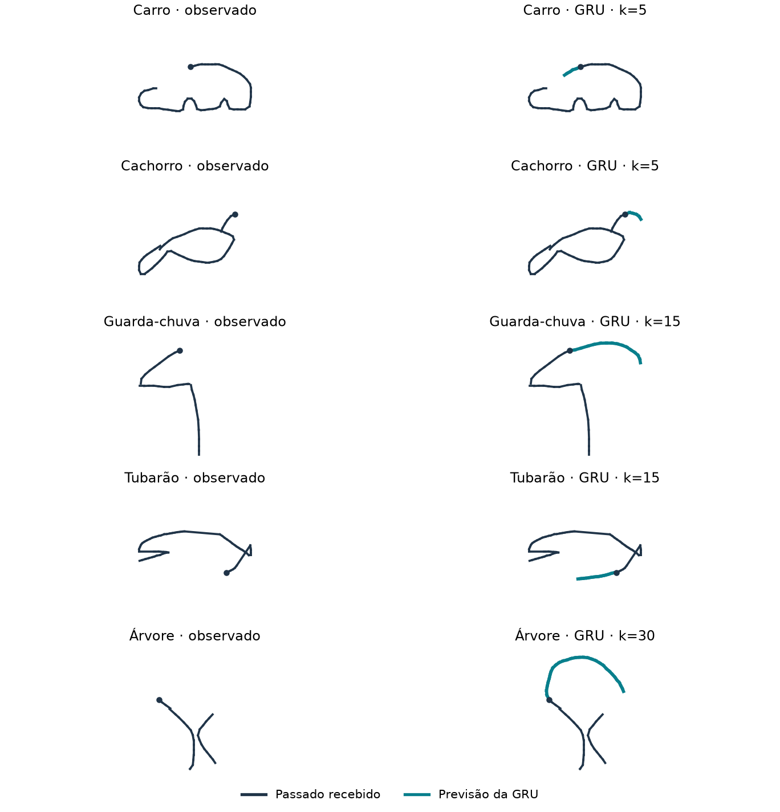
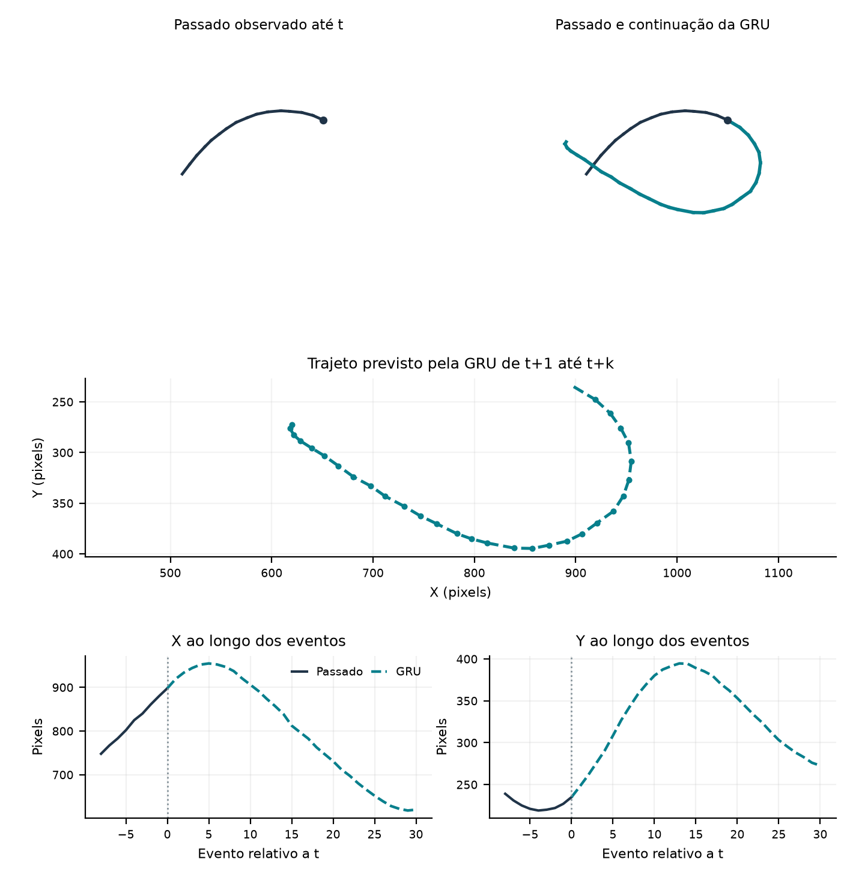
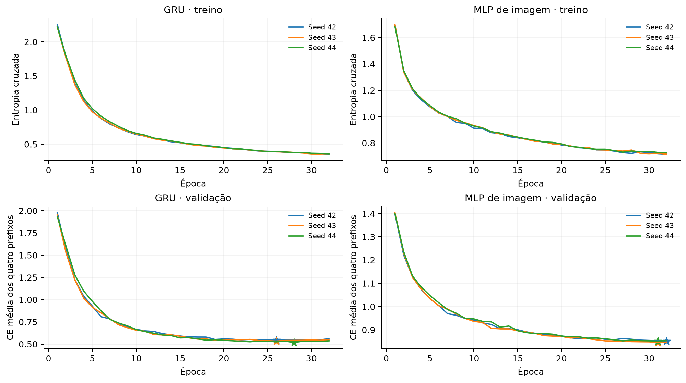
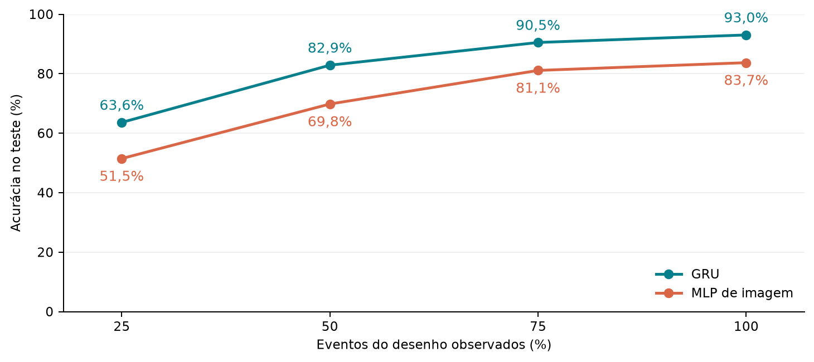
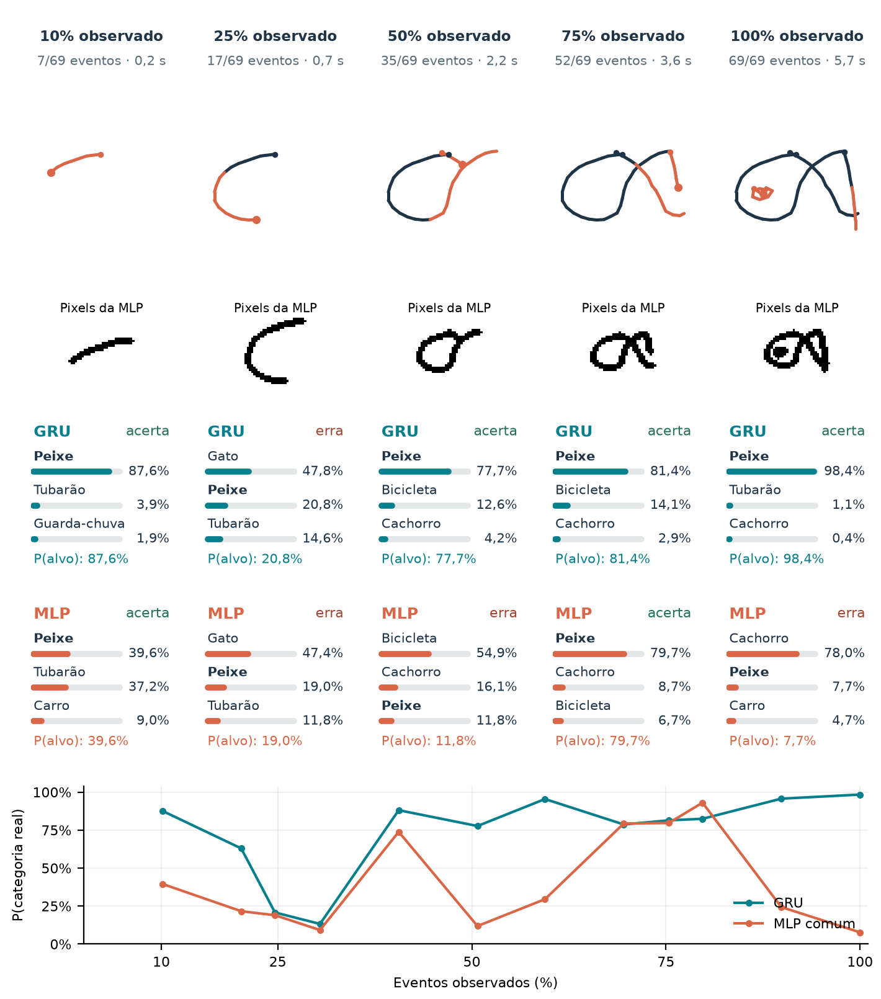
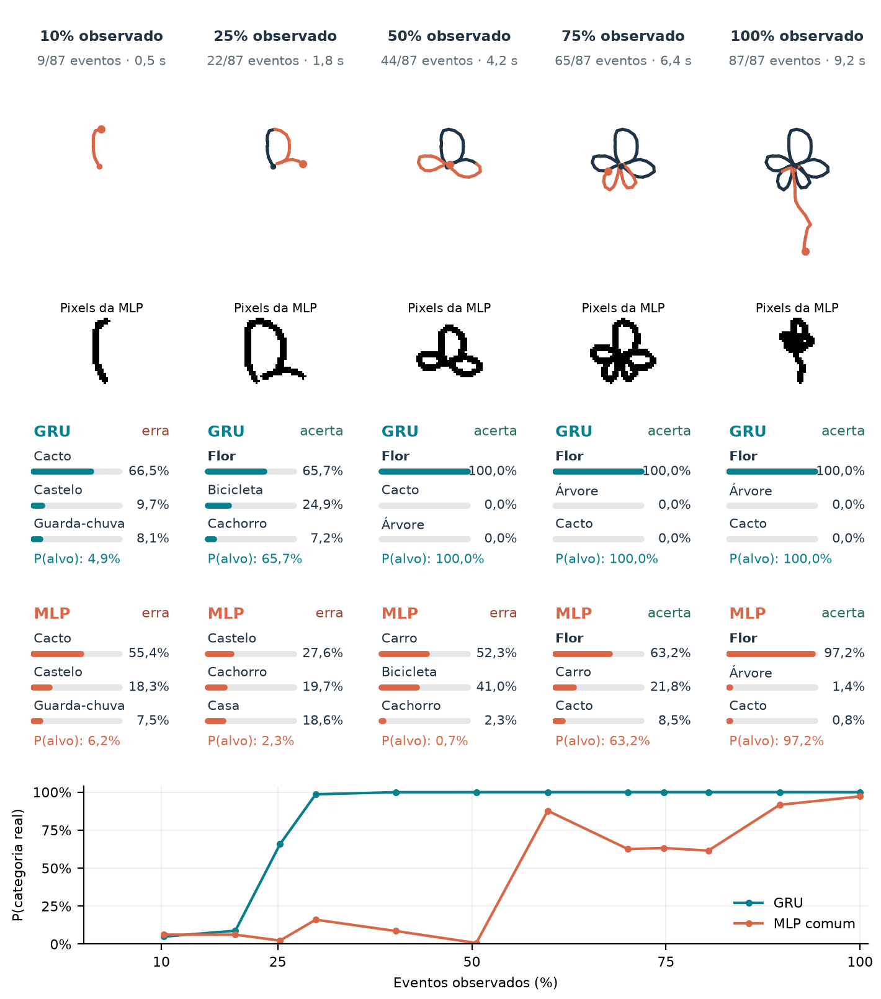
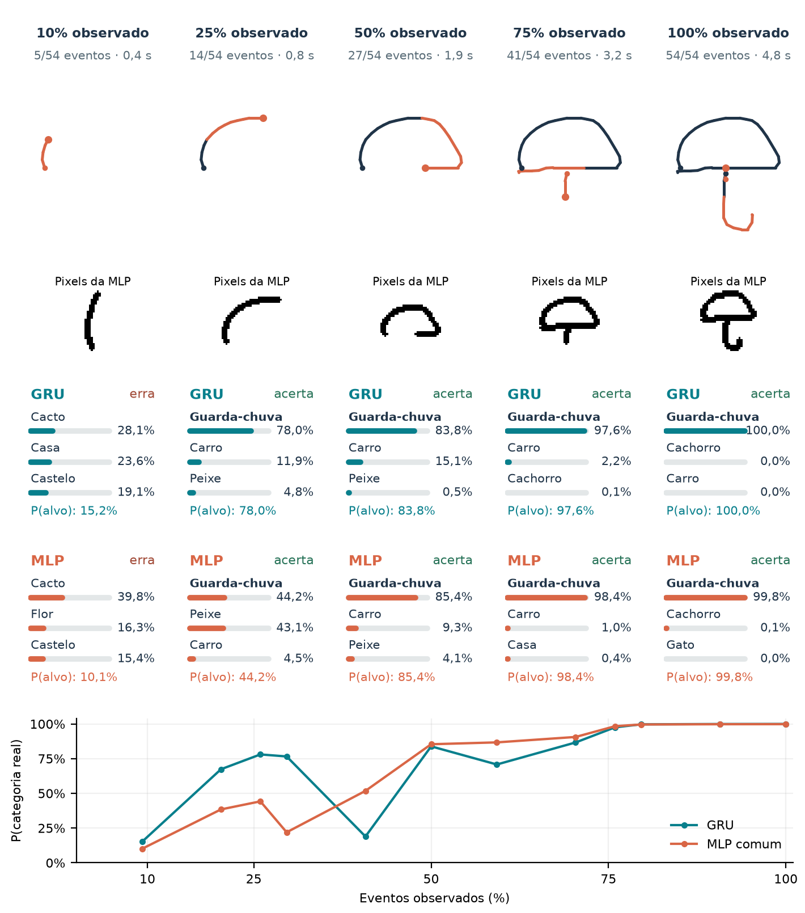
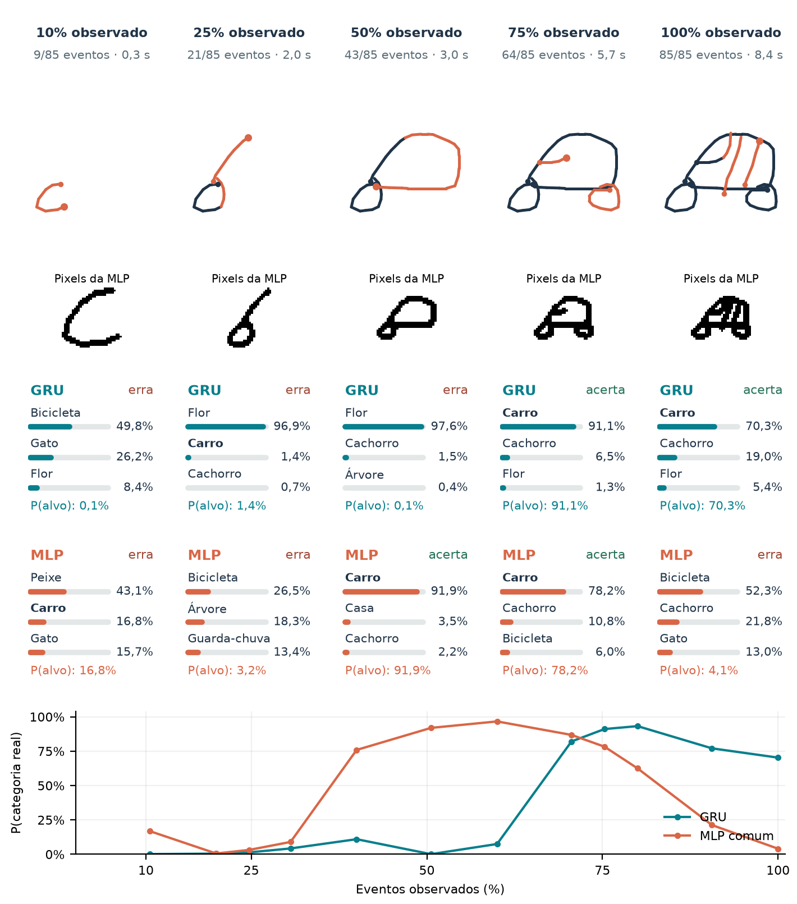

# Previsão de traços e reconhecimento de desenhos com redes neurais

Comparamos duas tarefas sobre 42 mil desenhos do Quick, Draw!. Uma GRU prevê os próximos 5, 15 ou 30 movimentos da caneta. Para reconhecer desenhos parciais, comparamos uma GRU que acompanha a sequência de pontos com uma MLP que recebe a imagem. Com metade do desenho, a acurácia foi de 82,9% na GRU e 69,8% na MLP.

## O que fizemos?

Usamos o Quick, Draw! para estudar duas tarefas. Primeiro, a GRU prevê os próximos movimentos da caneta a partir do trecho observado e da categoria fornecida. Depois, a GRU e a MLP tentam reconhecer a categoria de um desenho parcial.

Cada desenho guarda a categoria, as coordenadas dos pontos, seus tempos e os limites entre traços. Esses registros formam uma série temporal porque a ordem e os intervalos dos movimentos descrevem como o desenho foi feito. Trabalhamos com 42.000 desenhos de 12 categorias, divididos por desenho inteiro em 36.000 para treino, 3.000 para validação e 3.000 para teste. A validação orienta a escolha dos modelos. O desempenho é medido no teste.

O teste usa as mesmas partições dos estudos anteriores do projeto. O recorte contém desenhos reconhecidos pelo próprio jogo.

**As duas tarefas do projeto**

| Tarefa | Entrada | Saída |
|---|---|---|
| Previsão t+k | Movimentos e categoria | Próximos pontos da caneta |
| Reconhecimento | Movimentos ou imagem parcial | Probabilidades das 12 categorias |

## Previsão dos próximos traços (t+k)

### O que a GRU prevê

Entregamos à GRU até 64 eventos observados e a categoria do desenho. Com t=32 e k=15, por exemplo, ela recebe os primeiros 32 movimentos e devolve os eventos 33 a 47. Cada previsão inclui a posição, o estado da caneta e o intervalo desde o ponto anterior. O horizonte k pode ser de 5, 15 ou 30 eventos.

Cada ponto observado é representado por seis valores. São os deslocamentos X/Y, o indicador de fim de traço (pen-up), o intervalo de tempo comprimido com logaritmo e a posição X/Y relativa ao primeiro ponto. O pen-up marca quando a pessoa levanta a caneta ao terminar um trecho. A GRU resume a sequência em um estado. O decoder usa esse estado para escolher e ajustar uma entre 64 trajetórias-base da categoria, aprendidas no treino.

Testamos 128 e 192 unidades ocultas e taxas de aprendizagem de 0,001 e 0,0005. Treinamos com AdamW por 20 épocas. Os dois melhores candidatos da primeira inicialização foram repetidos com outra inicialização. A escolha usou o erro de posição e a capacidade de seguir até o fim do horizonte na validação, além do acerto de pen-up. A validação selecionou 192 unidades ocultas e taxa 0,001. Os resultados do teste usam a média de três inicializações.

### Aprendizagem e erro de previsão

ADE mede a distância média entre os pontos previstos e os registrados ao longo da janela futura. FDE mede a distância no último ponto. Quanto menores esses erros, mais próximo o traço ficou do desenho registrado. O erro cresce com o número de eventos previstos. Os resultados abaixo incluem todas as janelas elegíveis do teste para cada horizonte.

**Resultados da GRU no teste**

| Horizonte k | ADE (pixels) | FDE (pixels) |
|---|---|---|
| 5 | 44,7 | 71,3 |
| 15 | 94,8 | 149,2 |
| 30 | 138,6 | 196,5 |

As estrelas marcam as épocas escolhidas na validação para cada inicialização.

#### Cinco continuações dos exemplos de validação

Os exemplos vêm da validação. Selecionamos trechos com baixo erro de posição e uma continuação visualmente coerente.

À esquerda, a entrada. À direita, essa mesma entrada com os pontos previstos pela GRU em verde-azulado.

#### Exemplo em detalhe · peixe, k=30

Categoria fornecida: Peixe. A GRU observa 16 eventos e prevê os próximos 30. ADE de 17,49 px e FDE de 13,37 px. Validação, ID 4765551467429888, seed 42.

A linha escura mostra os 16 eventos observados. A linha verde-azulada mostra a continuação da GRU para os 30 eventos seguintes. As curvas detalham as coordenadas X e Y.

## Reconhecimento da categoria do desenho

### O que cada rede observa

As duas redes classificam os mesmos desenhos parciais. A GRU recebe pontos em ordem, com movimentos, tempos e fins de traço. A MLP recebe a imagem desses mesmos pontos, com 32 × 32 pixels achatados em um vetor. Cada rede devolve 12 probabilidades, e a categoria com maior probabilidade é o palpite.

Para cada rede, testamos duas larguras e taxas iniciais de 0,001 e 0,003. Os treinos duraram 32 épocas. Escolhemos a configuração pela perda de validação nos prefixos de 25%, 50%, 75% e 100% do desenho. As configurações vencedoras foram treinadas com três inicializações.

**Configurações escolhidas na validação**

| Rede | Largura principal | Taxa inicial |
|---|---|---|
| GRU | 192 | 0,003 |
| MLP de imagem | 256 | 0,001 |

Curvas de treino e validação das duas redes. As estrelas marcam as épocas escolhidas com base na validação.

### Acurácia conforme o desenho aparece

Acurácia é a porcentagem de desenhos em que a categoria com maior probabilidade está correta. O gráfico compara as duas redes nos mesmos 3.000 desenhos de teste. Cada ponto mostra a média de três inicializações.

Com metade do desenho, a GRU acertou 82,9% e a MLP acertou 69,8%. Com o desenho completo, os resultados foram 93,0% e 83,7%, respectivamente. Nos quatro cortes avaliados, a GRU teve maior acurácia. As redes usam arquiteturas e representações diferentes, então a comparação mede o efeito dessas escolhas em conjunto.

As próximas páginas mostram quatro desenhos de validação com resultados diferentes. No peixe desenhado livremente no site, a GRU atribuiu 97,5% a Peixe e o palpite principal da MLP foi Cachorro (33,9%). O peixe mostrado a seguir é outro desenho, de validação, com uma confusão semelhante.

Acurácia depois de observar 25%, 50%, 75% e 100% dos eventos.

#### Peixe · a GRU encontra a categoria

Nos últimos eventos, a GRU reconhece o peixe e a MLP dá sua maior probabilidade a Cachorro.

As colunas revelam 10%, 25%, 50%, 75% e 100% dos eventos. A imagem em preto e branco é a entrada da MLP. As barras mostram os três palpites de cada rede. A curva mostra a probabilidade da categoria correta.

#### Flor · a GRU acerta com metade do desenho

Os palpites dividem-se enquanto o contorno ainda está incompleto.

As colunas revelam 10%, 25%, 50%, 75% e 100% dos eventos. A imagem em preto e branco é a entrada da MLP. As barras mostram os três palpites de cada rede. A curva mostra a probabilidade da categoria correta.

#### Guarda-chuva · as duas redes reconhecem

Os novos traços tornam a forma mais clara para as duas redes.

As colunas revelam 10%, 25%, 50%, 75% e 100% dos eventos. A imagem em preto e branco é a entrada da MLP. As barras mostram os três palpites de cada rede. A curva mostra a probabilidade da categoria correta.

#### Carro · a MLP reconhece mais cedo neste caso

Neste desenho, com 50% dos pontos, a MLP acerta e a GRU ainda erra.

As colunas revelam 10%, 25%, 50%, 75% e 100% dos eventos. A imagem em preto e branco é a entrada da MLP. As barras mostram os três palpites de cada rede. A curva mostra a probabilidade da categoria correta.

### O que os resultados mostram

A GRU consegue continuar trechos curtos da caneta em exemplos como os da galeria. No teste, a previsão fica mais difícil conforme o horizonte cresce. No reconhecimento, as duas redes acertam mais quando recebem uma parte maior do desenho. A GRU obteve a maior acurácia média nos quatro cortes, e a galeria também inclui um exemplo em que a MLP acerta mais cedo.

## Referências

- [Google Creative Lab — Quick, Draw! Dataset e licença CC BY 4.0](https://github.com/googlecreativelab/quickdraw-dataset)
- [Cho et al. (2014) — artigo que apresenta a GRU](https://arxiv.org/abs/1406.1078)
- [Laboratório de previsão da GRU](https://martinelipedro.github.io/projeto4-irn/forecast/)
- [Laboratório de reconhecimento da GRU e da MLP](https://martinelipedro.github.io/projeto4-irn/)
- [Código, galeria completa e resultados do projeto](https://github.com/martinelipedro/projeto4-irn)
